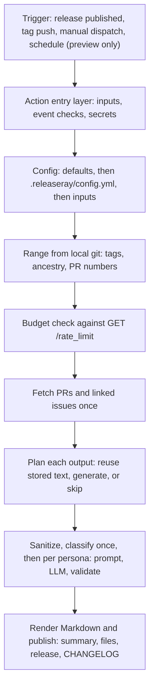

<div align="center">
  <h1>ReleaseRay</h1>
  <p><strong>Persona-specific release notes from your merged pull requests, written by a GitHub Action that runs on your own runner with your own LLM key.</strong></p>

[](https://github.com/cristobalmitchell/releaseray/actions/workflows/ci.yml)
[](LICENSE)
[](#project-status)
[](package.json)

[Website](https://www.releaseray.com) · [Roadmap](#roadmap) · [Contributing](CONTRIBUTING.md) · [Security](SECURITY.md)

</div>

---

> [!IMPORTANT]
> **ReleaseRay is not ready to use yet.** There is no release, no `action.yml` and no `v1` tag, so `uses: cristobalmitchell/releaseray@v1` does not work today. The generation core is built and tested; the configuration, pipeline and Action layer are in progress. Sections below say which parts exist and which are planned. Watch the repository or the [roadmap](#roadmap) for the first release.

## Table of contents

- [Overview](#overview)
- [How it will work](#how-it-will-work)
- [Features](#features)
- [Configuration](#configuration)
- [Architecture](#architecture)
- [Development](#development)
- [Testing](#testing)
- [Security and privacy](#security-and-privacy)
- [Project status](#project-status)
- [Roadmap](#roadmap)
- [Coming from the hosted ReleaseRay App](#coming-from-the-hosted-releaseray-app)
- [License](#license)

## Overview

### The problem

Release notes have more than one audience. Engineers want every change with its PR number and the upgrade steps. Customer-facing teams want the business impact and talking points. Customers want plain language and what they need to do. Writing three versions of the same release by hand is slow, and GitHub's generated notes are a list of PR titles that serves none of them well.

### The solution

ReleaseRay reads the pull requests and linked issues merged between two tags, groups them into sections, and writes one set of notes per persona with the LLM you choose. It then publishes to the places you already use: the GitHub Release, `CHANGELOG.md`, the job summary and files in the workspace.

It runs entirely inside your GitHub Actions workflow:

- **Your runner, your keys.** It uses `GITHUB_TOKEN` and your OpenAI, OpenAI-compatible or AWS Bedrock credentials. Nothing is sent anywhere except to GitHub and to the LLM provider you configure.
- **No service to sign up for.** There is no hosted backend, no account and no telemetry. The maintainer runs no infrastructure.
- **Customizable in your repository.** Personas, sections, tone, categories, exclusions and prompts live in `.releaseray/`, under version control with the rest of your code.
- **Safe to re-run.** Published text carries hidden markers, so re-running a release makes no LLM call and no write, and keeps edits people made by hand.

ReleaseRay began as a hosted GitHub App. This repository is its open-source successor, built from the same tested generation core.

## How it will work

> [!NOTE]
> This is the planned interface. It is not usable yet and may change before `v1.0.0`.

Add a workflow that runs when you publish a release:

```yaml
# .github/workflows/release-notes.yml
name: Release notes
on:
  release:
    types: [published]

permissions: {}

jobs:
  notes:
    runs-on: ubuntu-latest
    permissions:
      contents: write # update the GitHub Release
      pull-requests: read # read merged PRs
      issues: read # read linked issues
    steps:
      - uses: actions/checkout@<full-sha> # v7
        with:
          fetch-depth: 0 # all history and tags: the range is resolved locally
          persist-credentials: false
      - uses: cristobalmitchell/releaseray@<full-sha> # v1.0.0
        with:
          to: ${{ github.event.release.tag_name }}
        env:
          OPENAI_API_KEY: ${{ secrets.OPENAI_API_KEY }}
```

With no configuration, ReleaseRay:

1. Finds the previous tag: the highest SemVer tag that is an ancestor of the new one.
2. Reads the PR numbers from the commits between the two tags, then fetches each PR and its linked issues once.
3. Classifies the changes and writes notes for the built-in engineer, internal and customer personas.
4. Adds the engineer notes to the release body inside markers, shows public personas in the job summary, and writes every persona to workspace files.

Every task is a value of the `mode` input. There is no separate CLI.

| `mode`                  | What it does                                                                                   | LLM calls | Writes |
| ----------------------- | ---------------------------------------------------------------------------------------------- | --------- | ------ |
| `generate` (default)    | Writes notes and, on release events, publishes them                                            | Yes       | Yes    |
| `publish`               | Publishes notes generated in an earlier job, checked by digest                                 | No        | Yes    |
| `preview`               | Shows the range, the PRs found and an approximate classification; optionally the exact prompts | No        | No     |
| `doctor`                | Checks the token, permissions, clone depth, tags and rate-limit budget                         | No        | No     |
| `validate-config`       | Validates `.releaseray/config.yml` and reports every error                                     | No        | No     |
| `migrate-personas`      | Converts personas exported from the hosted App into `config.yml`                               | No        | No     |
| `adopt` (v1.1)          | Takes over release notes the hosted App already published, without duplicating them            | No        | Yes    |
| `sync-changelog` (v1.1) | Backfills `CHANGELOG.md` from existing release notes                                           | No        | Yes    |

Pin the Action to a full commit SHA. Releases are immutable, and the SHA is the only reference that cannot move.

## Features

✅ built and tested in this repository · 🚧 planned

### Personas

- ✅ **Three built-in personas.** _Engineer_: technical, complete, with PR references and upgrade instructions. _Internal_: business impact, customer talking points and objection handling for customer-facing teams. _Customer_: plain language, benefits first, breaking changes always first with the action required.
- ✅ **Tone sliders.** Formality, technical depth, enthusiasm and detail, each from 0 to 100, turned into writing instructions.
- ✅ **Section layouts per persona.** Each persona chooses which sections appear and in what order, and whether to show highlights, upgrade instructions and contributors.
- 🚧 **Your own personas** in `config.yml`, extending a built-in one or starting fresh, with free-text instructions.
- ✅ **Internal visibility flag.** The internal persona is marked internal. 🚧 On public repositories, internal text will be kept out of job summaries and workspace files, which anyone can read.

### Classification

- ✅ **Rules-based classifier** using labels, conventional-commit types, keywords, PR description structure, linked issues and, optionally, review comments. No code diffs are read.
- ✅ **Categories as data.** Add your own categories, such as _Infrastructure_, mapped to labels and commit types.
- ✅ **Exclusions.** Skip PRs by title pattern, for example promotion or release PRs. Nothing is excluded by default.
- ✅ **Breaking changes and security fixes always win** over other signals.
- ✅ **Commit fallback** for ranges with no pull requests.

### Writing and safety

- ✅ **One prompt per persona.** The model receives only that persona's rules, plus the PR and issue data as a single escaped block that the data cannot close.
- ✅ **Input sanitizing.** Secrets, tokens, internal URLs, file paths, emails and mentions are redacted before anything reaches the model. HTML comments, zero-width characters and bidirectional controls are removed, so hidden instructions don't get through.
- ✅ **Output validation.** Model output must parse against a schema, with retries.
- ✅ **Publish-time sanitizing.** Links outside an allow-list and secret-shaped strings are redacted from published text.
- 🚧 **Grounding checks.** References to PRs or issues that were not fetched are removed and counted; mentions become inline code so notes never notify anyone.

### LLM providers

- ✅ **OpenAI**, and any OpenAI-compatible endpoint through a base URL.
- ✅ **AWS Bedrock**, using the AWS SDK's standard credential chain, which is designed to pick up credentials from `aws-actions/configure-aws-credentials` (an end-to-end test is planned).
- 🚧 **Anthropic**, natively, in v1.1.
- ✅ **Cost estimates** from a built-in price table, with a check for models it doesn't know, so reports can show "n/a" instead of a false $0.

### Outputs

- ✅ **GitHub Release helpers.** Updates change only the body, so draft releases stay drafts and titles stay as you set them. New releases are named from a template and flagged as pre-releases from SemVer.
- 🚧 **GitHub Release output.** Notes go in a marked section of the release body, leaving the rest of the body alone.
- ✅ **`CHANGELOG.md` writer.** Entries follow [Keep a Changelog](https://keepachangelog.com), ordered by SemVer below an `[Unreleased]` section. Marked entries are replaced in place; entries written by hand are left alone.
- 🚧 **Job summary and workspace files**, with a `notes.json` for later steps.
- 🚧 **CHANGELOG push** with a retry loop for concurrent pushes, and a commit trailer that stops loops.
- 🚧 **Slack, Teams and Intercom** in v1.1.

### Reliability

- ✅ **Markers.** Every block ReleaseRay writes is wrapped in comments with room for a generation digest and a content hash. 🚧 Computing those digests comes with the pipeline.
- 🚧 **Idempotent re-runs.** If the inputs haven't changed, nothing is regenerated or rewritten. If someone edited the published text, ReleaseRay leaves it alone and warns. A failed CHANGELOG push is repaired by re-running, reusing the text already published.
- 🚧 **Rate-limit budget.** Before any LLM spend, ReleaseRay estimates the GitHub requests a release needs and checks them against the token's remaining budget. A release of 100 PRs needs about 150 requests; `GITHUB_TOKEN` allows 1,000 an hour.
- ✅ **SemVer ordering and pre-release detection.** `devtools-v1.2.0` is a release; `v1.2.0-rc.1` is a pre-release.
- 🚧 **Ancestry-aware ranges.** The previous tag will be the highest SemVer _ancestor_ of the new tag, which handles release branches and back-ported tags correctly.

## Configuration

> [!NOTE]
> Configuration is the next milestone. This shows the design; key names may change before `v1.0.0`.

ReleaseRay works without configuration. To customize it, add `.releaseray/config.yml`:

```yaml
# yaml-language-server: $schema=https://raw.githubusercontent.com/cristobalmitchell/releaseray/v1/schema/releaseray.schema.json
version: 1

range:
  tagPattern: "v*"

classification:
  categories:
    - id: infrastructure
      title: Infrastructure
      labels: ["area: infra"]
      conventionalTypes: [build, ci]
  exclude:
    labels: [skip-release-notes]
    titlePatterns: ["^chore\\(release\\):"]

personas:
  - slug: customer
    tone: { formality: 30, technicalDepth: 10, enthusiasm: 60, detail: 40 }
  - slug: sales
    extends: internal
    name: Sales enablement
    instructions: |
      Lead with the customer problem each change solves. One sentence per item.

outputs:
  githubRelease: { persona: engineer, mode: section }
  changelog: { enabled: true, persona: engineer }

llm:
  provider: openai
  model: gpt-5-mini
```

Configuration comes from three layers, each overriding the one before: built-in defaults, then `.releaseray/config.yml`, then the Action's inputs. Prompt templates can be overridden with files in `.releaseray/prompts/`. A published JSON Schema will let editors flag mistakes as you type, and `mode: validate-config` checks a config without any secrets.

## Architecture



### Repository layout

```text
src/
├── action/              # the only code that talks to the runner (@actions/*, process.env)
├── config/              # built-in personas and section layouts; config schema (planned)
├── core/
│   ├── classify/        # rules classifier, patterns, linked issues, commit fallback
│   ├── llm/             # schema-validated calls; OpenAI and Bedrock providers
│   ├── prompt/          # one persona prompt builder, templates, tone wording
│   ├── range/           # PR-number extraction with exclusions
│   ├── render/          # Markdown rendering and heading shift
│   ├── sanitize/        # LLM-input, publish-time and redaction sanitizers
│   ├── state/           # markers for idempotent re-runs
│   ├── util/            # retry with backoff, SemVer
│   ├── logger.ts        # structured logger with an injected sink
│   └── index.ts         # curated public entry point
└── outputs/             # GitHub Release helpers and CHANGELOG writer
prompts/                 # bundled system and persona prompt templates
scripts/                 # CI guards: dependency, import-boundary and carried-test checks
test/
├── carried/             # tests carried over from the hosted product, with a manifest
├── unit/                # tests for new behavior
├── fixtures/            # recorded data, such as PR-number extraction cases
└── scripts/             # tests for the CI guards
```

### Design rules

- **The core is pure.** Nothing outside `src/action/` imports `@actions/core` or `@actions/github` or reads the environment. A CI check enforces this, so the core stays testable without a workflow run, and a CLI could be added later as a thin wrapper.
- **One Action, one bundle.** It will ship as a single JavaScript file on Node 24, committed to `dist/` and checked in CI so the bundle always matches the source.
- **No hosting dependencies.** A CI guard fails if the lockfile ever contains the SDKs of the hosted product's services, such as Prisma, Supabase, BullMQ, Stripe or Vercel.
- **Small surface.** Configuration and prompt files instead of plugins; recipes instead of built-in integrations for anything users can do with a workflow step.

## Development

### Prerequisites

- Node.js 24
- pnpm 10 (the version is pinned in `package.json`)

```bash
pnpm install
pnpm lint            # ESLint
pnpm typecheck       # TypeScript, strict
pnpm test            # Vitest
pnpm format:check    # Prettier
pnpm check:deps      # no hosted-product SDKs in the lockfile
pnpm check:boundary  # @actions/* and process.env only in src/action/
pnpm check:carried   # carried tests match test/carried/manifest.json
```

### Continuous integration

Every pull request runs these jobs. All must pass before a merge to `main`.

| Job              | Checks                                                                    |
| ---------------- | ------------------------------------------------------------------------- |
| `lint`           | ESLint and Prettier                                                       |
| `typecheck`      | `tsc --noEmit` in strict mode                                             |
| `test`           | The full Vitest suite; failures are never ignored                         |
| `secret-scan`    | gitleaks over the working tree                                            |
| `check-deps`     | No hosted-product SDK in `pnpm-lock.yaml`                                 |
| `check-boundary` | The core stays free of runner and environment access                      |
| `check-carried`  | Every carried test is still present, and the totals go to the job summary |

### Conventions

- Short-lived branches named `{type}/{issue}-{description}`, for example `fix/42-changelog-ordering`, merged into `main` by squash.
- [Conventional Commits](https://www.conventionalcommits.org) with the issue number: `fix(changelog): keep [Unreleased] first (#42)`.
- Releases are cut from `main` by tag, and tags are immutable.

See [CONTRIBUTING.md](CONTRIBUTING.md) for the full guide.

## Testing

The suite has more than 500 tests, in two groups:

- **Carried tests.** 419 tests came over from the hosted product with the code they cover; 46 of them were edited where behavior changed on purpose. `test/carried/manifest.json` records each one, and 66 tests of code that wasn't carried over, as `carry`, `edit` or `retire`, with a reason. `pnpm check:carried` fails if a carried test goes missing or an unlisted one appears in a carried file.
- **Unit tests** for everything new, including the sanitizer fixes, the persona prompt builder, categories as data, the injected LLM provider, SemVer pre-release detection, CHANGELOG markers and PR-number extraction. That last one is checked against PR numbers recorded from 34 real release ranges.

Tests set no environment variables, and any token-shaped test value is assembled at run time so secret scanners stay quiet.

## Security and privacy

- **Data stays in your workflow.** ReleaseRay sends PR and issue text only to the LLM provider you configure, after redacting secrets and personal data. It has no telemetry.
- **Least-privilege tokens.** `GITHUB_TOKEN` is enough for most repositories. A fine-grained token or a GitHub App token you register is needed only for protected branches, triggering other workflows, or a larger request budget.
- **Prompt injection.** PR and issue text is untrusted. It reaches the model only as escaped data, hidden text is stripped, and published output is filtered for links, mentions, HTML and images.
- **Supply chain.** Immutable releases, full-SHA pinning in every example, few dependencies and Dependabot today; a committed bundle that CI rebuilds and compares is planned.

Please report vulnerabilities privately: see [SECURITY.md](SECURITY.md).

## Project status

| Area                                                                                                    | Status          |
| ------------------------------------------------------------------------------------------------------- | --------------- |
| Generation core: prompts, sanitizers, classifier, LLM providers, release and CHANGELOG helpers, markers | ✅ Done, tested |
| Configuration, range resolution, rate-limit budget                                                      | 🚧 In progress  |
| Output validation, idempotency planner, pipeline                                                        | 🚧 Planned      |
| `action.yml`, modes, publishing, end-to-end tests                                                       | 🚧 Planned      |
| `v1.0.0` release and Marketplace listing                                                                | 🚧 Planned      |

## Roadmap

1. **Core extraction.** ✅ The generation core, lifted from the hosted product with its tests, fixes and CI guards.
2. **Pipeline and config.** Configuration schema and loader, range resolution from local git, the rate-limit budget, fetching, output validation, digests, the per-output planner and the `generate`, `preview`, `doctor`, `validate-config` and `migrate-personas` logic.
3. **Action and publishing.** `action.yml`, the GitHub Release and CHANGELOG outputs with the push loop, example workflows, end-to-end tests on sandbox repositories, and `v1.0.0-beta` pre-releases.
4. **`v1.0.0`.** Provider contract tests, a prompt-injection test suite, complete documentation and the Marketplace listing.
5. **`v1.1.0`.** Slack, Teams and Intercom outputs, the native Anthropic provider, and the `adopt` and `sync-changelog` modes for teams moving off the hosted App.
6. **On request.** GraphQL enrichment, GitHub Enterprise Server, PR preview comments, signed CHANGELOG commits and other extras, when users ask for them.

## Coming from the hosted ReleaseRay App

The hosted App is being retired in favor of this Action. Once `v1.1.0` is out, a migration path will cover:

- `mode: migrate-personas`, to turn personas exported from the hosted dashboard into `.releaseray/config.yml`;
- `mode: adopt`, so releases the App already published are taken over instead of written twice;
- `mode: sync-changelog`, to backfill `CHANGELOG.md`.

The hosted App's users will hear about the timeline directly before anything changes.

## License

[MIT](LICENSE) © 2026 Cristobal Mitchell
