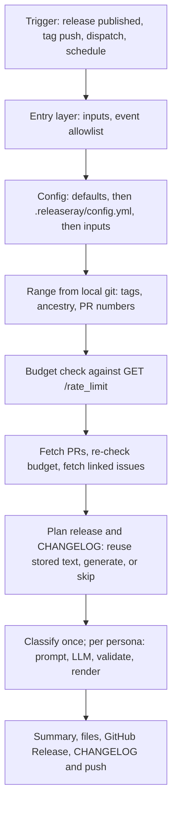

<div align="center">
  <h1>ReleaseRay</h1>
  <p><strong>Persona-specific release notes from your merged pull requests, written by a GitHub Action that runs on your own runner with your own LLM key.</strong></p>

[](https://github.com/cristobalmitchell/releaseray/actions/workflows/ci.yml)
[](LICENSE)
[](#project-status)
[](package.json)

[Website](https://www.releaseray.com) · [Configuration](docs/configuration.md) · [Security](docs/security.md) · [Contributing](CONTRIBUTING.md)

</div>

---

> [!IMPORTANT]
> **Not released yet.** The Action, its modes and its outputs are built and tested, but there is no `v1.0.0` tag, so `uses: cristobalmitchell/releaseray@v1` does not resolve yet. The quickstart below is what you will run once `v1.0.0` is published; end-to-end tests on sandbox repositories come first ([project status](#project-status)).

## Table of contents

- [What it does](#what-it-does)
- [Quickstart](#quickstart)
- [Starter config](#starter-config)
- [Workflows](#workflows)
- [Modes, inputs and outputs](#modes-inputs-and-outputs)
- [Troubleshooting](#troubleshooting)
- [How it works](#how-it-works)
- [Security and privacy](#security-and-privacy)
- [Development](#development)
- [Project status](#project-status)
- [Coming from the hosted ReleaseRay App](#coming-from-the-hosted-releaseray-app)
- [License](#license)

## What it does

A single release usually has several readers: engineers who need the API changes, a support or customer-success team that needs talking points, and customers who need plain language. ReleaseRay writes one version for each, from the pull requests and issues merged between two tags.

- **Personas.** Three built in (`engineer`, `internal`, `customer`); retune their tone, sections and instructions, or add your own, in `.releaseray/config.yml`.
- **From your history.** Tags, ancestry and commits come from your checkout. Each pull request and linked issue is fetched once per release, within a request budget it checks before it starts.
- **Your model, your key.** OpenAI (or any OpenAI-compatible endpoint), Anthropic, or AWS Bedrock. Nothing goes anywhere else, and there is no telemetry.
- **Safe to publish.** Repository text reaches the model only as escaped data. Output is checked against what was fetched: invented references, off-allowlist links, live mentions, HTML and images are removed.
- **Idempotent.** Marked blocks in the GitHub Release and `CHANGELOG.md` record what was generated. A re-run with nothing changed makes no LLM call and no write; a block someone edited by hand is left alone.
- **Outputs.** Job summary, workspace files with `notes.json`, the GitHub Release, and `CHANGELOG.md` with an optional push.

## Quickstart

1. Add your model key as a repository secret named `OPENAI_API_KEY` (Settings → Secrets and variables → Actions).
2. Add `.github/workflows/release-notes.yml`:

```yaml
name: Release notes
on:
  release:
    types: [published]
  workflow_dispatch:
    inputs:
      to:
        description: "Tag, or HEAD for a preview"
        type: string
        required: true
      publish:
        description: Update the GitHub Release
        type: boolean
        default: false

permissions: {}

concurrency:
  group: releaseray-${{ github.event.release.tag_name || inputs.to }}
  cancel-in-progress: false

jobs:
  notes:
    runs-on: ubuntu-latest
    timeout-minutes: 20
    permissions:
      contents: write
      pull-requests: read
      issues: read
    steps:
      - uses: actions/checkout@3d3c42e5aac5ba805825da76410c181273ba90b1 # v7.0.1
        with:
          fetch-depth: 0
          persist-credentials: false
      - uses: cristobalmitchell/releaseray@v1 # pin to the v1.0.0 commit SHA
        with:
          to: ${{ github.event.release.tag_name || inputs.to }}
          publish: ${{ github.event_name == 'release' || inputs.publish }}
        env:
          OPENAI_API_KEY: ${{ secrets.OPENAI_API_KEY }}
```

3. Publish a release. The engineer notes are appended to the release body, and every persona appears in the job summary. To try it on an existing tag without writing anything, run the workflow by hand with `publish` off.

No config file is needed: the defaults write for the three built-in personas. Add `.releaseray/config.yml` (below) to change them.

## Starter config

Copy this to `.releaseray/config.yml`. The first line lets editors with a YAML language server check the file as you type; `mode: validate-config` runs the same checks in a workflow.

```yaml
# yaml-language-server: $schema=https://raw.githubusercontent.com/cristobalmitchell/releaseray/v1/schema/releaseray.schema.json
version: 1

classification:
  exclude:
    labels: [skip-release-notes, dependencies]
    authors: ["dependabot[bot]", "renovate[bot]"]

personas:
  - slug: customer
    tone: { formality: 30, technicalDepth: 10, enthusiasm: 60, detail: 40 }
    instructions: Lead each item with what the user can now do.

outputs:
  githubRelease: { persona: engineer }
  changelog: { enabled: false }

llm:
  provider: openai
  model: gpt-5-mini
```

Every key is documented in the [configuration reference](docs/configuration.md); [`examples/config/releaseray.yml`](examples/config/releaseray.yml) uses most of them.

## Workflows

| Example                                                                         | When to use it                                                                                                                      |
| ------------------------------------------------------------------------------- | ----------------------------------------------------------------------------------------------------------------------------------- |
| [`release-notes.yml`](examples/workflows/release-notes.yml)                     | The quickstart: on every published release, plus a manual dispatch                                                                  |
| [`release-notes-hardened.yml`](examples/workflows/release-notes-hardened.yml)   | Public repositories that merge outside contributions: the job with the LLM key cannot write, the job that writes never sees the key |
| [`release-notes-on-tag.yml`](examples/workflows/release-notes-on-tag.yml)       | A pushed tag creates the release and pushes the CHANGELOG entry                                                                     |
| [`in-release-job.yml`](examples/workflows/in-release-job.yml)                   | Inside an existing release job whose tags are pushed with `GITHUB_TOKEN`                                                            |
| [`in-release-job-dispatch.yml`](examples/workflows/in-release-job-dispatch.yml) | Release jobs on `workflow_run`, which dispatch the quickstart workflow                                                              |
| [`release-notes-preview.yml`](examples/workflows/release-notes-preview.yml)     | A weekly draft of unreleased changes; never publishes                                                                               |
| [`releaseray-tools.yml`](examples/workflows/releaseray-tools.yml)               | `preview`, `doctor`, `validate-config` and `migrate-personas` on demand                                                             |

Recipes: [CHANGELOG as a pull request](examples/recipes/changelog-pr.yml), [GitHub App token](examples/recipes/app-token.yml), [notes as an artifact](examples/recipes/artifact.yml).

Every example grants nothing at workflow level, pins third-party actions to a full commit SHA, and passes values to scripts through `env:`, never inline.

## Modes, inputs and outputs

| `mode`               | What it does                                                                                                        | LLM                                | Writes                                |
| -------------------- | ------------------------------------------------------------------------------------------------------------------- | ---------------------------------- | ------------------------------------- |
| `generate` (default) | Range, fetch, generate per persona, then publish when `publish` is true                                             | Yes, unless stored text is current | Release and CHANGELOG when publishing |
| `publish`            | Write job of the hardened split: writes from a `notes.json` whose digest matches                                    | No                                 | Release and CHANGELOG                 |
| `preview`            | Range, PR count, approximate classification and budget estimate; with `preview-prompts`, the exact prompts as files | Never                              | Nothing                               |
| `doctor`             | Checks configuration, checkout, tags, token, credentials and visibility                                             | Never                              | Nothing                               |
| `validate-config`    | The run's config checks, with no secrets                                                                            | Never                              | Nothing                               |
| `migrate-personas`   | Converts the hosted App's persona YAML into a config file in the workspace                                          | Never                              | Nothing on GitHub                     |

**Inputs.** Blank values fall back to the defaults shown.

| Input                          | Default                          | Meaning                                                                                     |
| ------------------------------ | -------------------------------- | ------------------------------------------------------------------------------------------- |
| `mode`                         | `generate`                       | See above                                                                                   |
| `github-token`                 | `github.token`                   | `GITHUB_TOKEN`, a fine-grained PAT, or a GitHub App token; also used for the CHANGELOG push |
| `config`                       | `.releaseray/config.yml`         | Config path (for `migrate-personas`, where to write)                                        |
| `to`                           | the event's tag                  | End tag, or `HEAD` for unreleased changes                                                   |
| `from`                         | highest-SemVer ancestor tag      | Start tag                                                                                   |
| `since`, `until`, `key`        |                                  | Date window instead of tags; `key` names it                                                 |
| `personas`                     | all enabled                      | Comma-separated slugs                                                                       |
| `publish`                      | true on `release` and tag pushes | Write the GitHub targets                                                                    |
| `create-release`               | `false`                          | Create the release when none exists                                                         |
| `push`                         | `outputs.changelog.push`         | Push the CHANGELOG entry                                                                    |
| `notes-dir`, `expected-digest` |                                  | For `publish`: the artifact path and the generate job's `notes-digest`                      |
| `allow-non-ancestor`           | `false`                          | Allow an explicit `from` on another line of history                                         |
| `force`                        | `false`                          | Regenerate even when stored text is current                                                 |
| `allow-sparse`                 | `false`                          | Generate even when the input is thin                                                        |
| `preview-prompts`              | `false`                          | For `preview`: fetch and write the exact prompts                                            |
| `personas-file`                | `.releaseray/personas.yml`       | For `migrate-personas`                                                                      |
| `all-tags`, `notify`           |                                  | Reserved for `adopt`, `sync-changelog` and notifications in v1.1                            |

**Outputs:** `key`, `from`, `to`, `notes-dir`, `notes-digest`, `release-url`, `release-changed`, `changelog-changed`, `github-requests`, `llm-calls`, `llm-cost-usd` (`n/a` when the model's price is unknown).

**Secrets** are environment variables, never inputs: `OPENAI_API_KEY`, `ANTHROPIC_API_KEY` (with `llm.provider: anthropic`), or the AWS credentials for Bedrock (`AWS_ACCESS_KEY_ID`, `AWS_SECRET_ACCESS_KEY`, `AWS_SESSION_TOKEN`, for example from `aws-actions/configure-aws-credentials`).

## Troubleshooting

Start with the `doctor` mode from the tools workflow; its summary is what an issue report needs.

| Exit code | Meaning                                                                   | Usual fix                                                                                             |
| --------- | ------------------------------------------------------------------------- | ----------------------------------------------------------------------------------------------------- |
| 2         | Configuration, input, event or range error                                | Read the error annotations; `mode: validate-config` lists config problems                             |
| 3         | The request budget or prompt size does not fit, or GitHub refused a write | Turn off `enrichment.comments`, lower `maxLinkedIssues` or `maxBodyChars`, or pass a PAT or App token |
| 4         | GitHub data could not be fetched completely                               | Check the token's permissions; re-run after a rate-limit reset                                        |
| 5         | The model's output was invalid after retries, or the input was too thin   | Re-run, try another model, or set `allow-sparse`                                                      |
| 6         | The CHANGELOG push was rejected                                           | Use the App-token recipe or the CHANGELOG pull request recipe                                         |
| 7         | One output was written and another failed                                 | Re-run: written outputs are no-ops                                                                    |

**No notes for a release.**

- _Releases or tags created with `GITHUB_TOKEN` start no workflows._ If semantic-release or another workflow publishes your releases, use [`in-release-job.yml`](examples/workflows/in-release-job.yml) or dispatch the quickstart workflow from that job.
- _Runs waiting for approval._ On public repositories, GitHub can hold a run it flags until a collaborator with write access approves it; look for a pending run on the Actions tab.
- _Draft releases._ Creating or editing a draft starts nothing; publishing it does.
- _More than three tags pushed at once_ start no tag-push runs; dispatch the quickstart workflow per tag.

**"The checkout is shallow".** Set `fetch-depth: 0` on `actions/checkout`; ranges are resolved from local tags.

**"No commit in the range names a pull request".** Pull request numbers come from `Merge pull request #n` and `(#n)` in commit subjects. Rebase merges keep neither, so the notes fall back to commit messages. Squash or merge commits give the best notes.

**A hand-edited block was not updated.** That is `onHumanEdit: skip` protecting the edit. Set it to `overwrite`, or delete the block to regenerate it.

**The release was created without notes.** `GITHUB_TOKEN` cannot create a release whose commit changes `.github/workflows/`. Pass a PAT or App token as `github-token` (see [docs/tokens.md](docs/tokens.md)).

## How it works



```text
action.yml               # inputs, outputs, node24, dist/action.js
dist/                    # committed single-file bundle and bundled licenses
src/
├── action/              # the only code that touches the runner (@actions/core, process.env)
├── modes/               # generate, publish, preview, doctor, validate-config, migrate-personas
├── config/              # schema, loader, resolution, built-in personas and categories
├── core/
│   ├── range/           # tags, ancestry, windows, PR numbers
│   ├── fetch/           # request policy, budget gate, content fetch
│   ├── classify/        # rules classifier, linked issues, commit fallback
│   ├── prompt/          # persona prompt builder, bundled templates, tone
│   ├── llm/             # providers (OpenAI, Anthropic, Bedrock, fake) and draft generation
│   ├── validate/        # output validation, input size and sufficiency
│   ├── state/           # markers, digests, per-output planner
│   ├── sanitize/        # input, publish and redaction sanitizers
│   └── run.ts           # the pipeline
└── outputs/             # files, summary, GitHub Release, CHANGELOG, push loop
schema/                  # JSON Schema for the config, generated
examples/                # workflows, recipes, a complete config
docs/                    # configuration, security, tokens, migration
```

**Design rules.** The core never reads the environment or imports `@actions/*` (a CI check enforces it). One committed bundle that CI rebuilds and compares. No hosting dependencies (a lockfile guard). Recipes instead of built-in integrations for anything a workflow step can do.

## Security and privacy

- PR and issue text goes only to the LLM provider you configure, after secrets and personal data are redacted. No telemetry.
- `GITHUB_TOKEN` is enough for most repositories; [docs/tokens.md](docs/tokens.md) covers when a PAT or App token is needed.
- Repository text is untrusted. [docs/security.md](docs/security.md) describes the prompt-injection defenses and the test suite behind them, internal-persona visibility, and the hardened workflow.

Report vulnerabilities privately: see [SECURITY.md](SECURITY.md).

## Development

Node.js 24 and pnpm 10 (pinned in `package.json`).

```bash
pnpm install
pnpm lint && pnpm typecheck && pnpm test
pnpm test:injection   # the prompt-injection suite alone
pnpm build            # dist/action.js and dist/licenses.txt
pnpm schema           # schema/releaseray.schema.json and docs/configuration.md
pnpm prompts          # src/core/prompt/bundled.ts from prompts/*.md
```

CI runs lint, typecheck, the full test suite, gitleaks, actionlint, and guards that fail when the lockfile gains a hosted-product SDK, the core reaches the runner, a carried test goes missing, or `dist/`, the schema, the configuration reference or the bundled prompts are stale. Setting `RELEASERAY_LLM_FAKE=true` swaps in a deterministic fake model, for tests and the end-to-end harness only.

The suite has close to 800 tests. 419 came over from the hosted product with the code they cover (46 of them edited where behavior changed on purpose), recorded in `test/carried/manifest.json` and checked by `pnpm check:carried`. Golden tests compare persona files and `notes.json` byte for byte; range tests build real repositories with diverging release lines; the push loop is tested against a local bare remote.

Branches are `{type}/{issue}-{description}`, commits follow [Conventional Commits](https://www.conventionalcommits.org) with the issue number, and merges to `main` are squashed. See [CONTRIBUTING.md](CONTRIBUTING.md).

## Project status

| Area                                                                                | Status              |
| ----------------------------------------------------------------------------------- | ------------------- |
| Generation core, configuration, range, budget, fetch, validation, planner, pipeline | ✅ Built and tested |
| `action.yml`, all six modes, GitHub Release, CHANGELOG and push loop, bundle        | ✅ Built and tested |
| Example workflows and recipes, provider contract tests, prompt-injection suite      | ✅ Built and tested |
| Anthropic provider                                                                  | ✅ Built and tested |
| End-to-end tests on sandbox repositories, `v1.0.0-beta.1`                           | 🚧 Next             |
| `v1.0.0` and the Marketplace listing                                                | 🚧 After the beta   |
| `v1.1.0`: Slack, Teams and Intercom, `adopt` and `sync-changelog`                   | Planned             |

## Coming from the hosted ReleaseRay App

The hosted App is being retired in favor of this Action. [docs/migrating-from-hosted.md](docs/migrating-from-hosted.md) maps every hosted setting to a config key. `mode: migrate-personas` converts the persona YAML downloaded from the hosted dashboard today; `adopt` and `sync-changelog`, which take over releases the App already published, arrive in `v1.1.0`. The App's users will hear about the timeline directly before anything changes.

## License

[MIT](LICENSE) © 2026 Cristobal Mitchell
